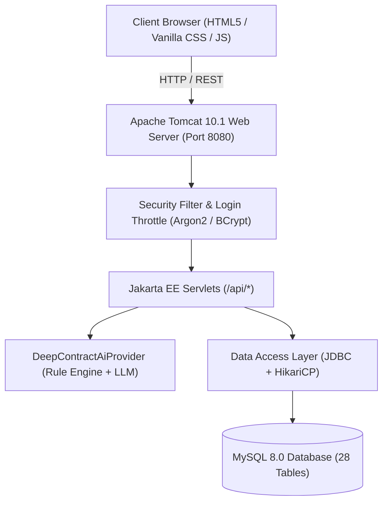

# ClauseLens — AI-Powered Contract Risk Analysis & Freelancer Protection Platform

[](https://www.oracle.com/java/)
[](https://jakarta.ee/)
[](https://tomcat.apache.org/)
[](https://www.mysql.com/)
[](https://maven.apache.org/)
[](https://vishal220729.github.io/ClauseLens/)
[](LICENSE)

> **ClauseLens** is a mission-critical web platform designed to empower independent contractors, freelancers, and small enterprises. It acts as an autonomous legal risk guardian by scanning contracts for predatory terms, highlighting exact clause citations, proposing fair counter-terms, securing escrow milestone payments, and managing mutual dual-party cryptographic digital signatures.

---

## 🌐 Live Demos & Portal Access

| Portal | Live Link / Host URL | Description |
| :--- | :--- | :--- |
| **Main Landing & Auth** | `http://localhost:8080/clauselens/index.html` | High-converting landing page, brand animations, unified auth |
| **Freelancer Workspace** | `http://localhost:8080/clauselens/freelancer-dashboard.html` | Contract analyzer, project milestones, reward points, wallet |
| **Company Management Portal** | `http://localhost:8080/clauselens/company-dashboard.html` | Job posting, proposal review, agreement drafting, payment releases |
| **Super Admin Console** | `http://localhost:8080/clauselens/admin-dashboard.html` | Platform health metrics, user moderation, audit logs |

---

## 🎯 The Problem & Our Solution

### The Challenge
Freelancers and digital agencies lose billions annually to one-sided client contracts:
* **Net-60 / Net-90 Delayed Payments:** Clients withholding earned funds indefinitely.
* **Scope Creep & Unlimited Revisions:** Ambiguous deliverables forcing endless unpaid work.
* **Aggressive IP Assignment:** Clients claiming ownership of pre-existing tools and work before payment.
* **Uncapped Liability & Indemnification:** Freelancers held liable for client-side business losses.
* **No Access to Legal Counsel:** Hiring attorneys costs $300-$800/hour, making contract vetting inaccessible.

### The ClauseLens Solution
1. **Instant AI Risk Radar:** Upload any contract (`.pdf`, `.docx`, or raw text). Within seconds, ClauseLens highlights all risky clauses with exact sentence quotes and severity classifications (HIGH, MEDIUM, LOW).
2. **Deterministic Policy Rules:** Freelancers define their standard business terms (e.g., minimum 30% advance deposit, max 3 revisions, 15-day payment window). ClauseLens flags every violation against these rules.
3. **Dual-Party Cryptographic Signatures:** Eliminates disputes through dual-sealed legal agreements with SHA-256 tamper-evident digital hashes.
4. **Milestone Escrow Protection:** Advance deposits are committed before work begins; funds release automatically upon mutual milestone sign-off.
5. **Gamified Good Habits:** Freelancers earn +100 XP / Reward Points for enforcing healthy milestone check-ins and fair contract terms.

---

## 🚀 Key Modules & Capabilities

```
+-----------------------------------------------------------------------------------+
|                                CLAUSELENS PLATFORM                                |
+-----------------------------------------------------------------------------------+
       |                        |                         |                  |
       v                        v                         v                  v
+--------------+      +-------------------+      +------------------+  +-----------+
|  AI CONTRACT |      |  JOB MARKETPLACE  |      |   ESCROW & SAFE  |  | GAMIFIED  |
|   ANALYZER   |      |  & PROPOSALS      |      |     PAYMENTS     |  |  REWARDS  |
+--------------+      +-------------------+      +------------------+  +-----------+
  - Text Extraction     - Job Postings             - 30% Upfront Lock    - XP Points
  - 15+ Risk Vectors    - Proposal Bidding         - 50% Milestone Sign  - Badges
  - Verbatim Quotes     - Status Tracking          - Wallet & Payout     - Leaderboard
  - Counter-Proposals   - Chat Messaging           - Auto Reminders      - Audit Logs
```

### 1. 🔍 Deep Contract Risk Analyzer
* **Multi-Format Extraction:** Seamlessly parses PDF (Apache PDFBox), DOCX (Apache POI), and plain text.
* **Risk Categorization:**
  * `POLICY_CONFLICT`: Clauses violating freelancer-defined rules.
  * `POTENTIAL_RISK`: Hidden liabilities, unilateral termination without notice.
  * `MISSING_PROTECTION`: Missing payment schedules, no late payment interest, undefined deliverables.
  * `AMBIGUOUS_CLAUSE`: Subjective satisfaction clauses ("client must be satisfied before payment").
* **Balanced Counter-Proposals:** Provides ready-to-copy negotiation language crafted to protect contractor rights while preserving client goodwill.

### 2. ✍️ Dual-Party Agreements & Cryptographic Seals
* **Collaborative Drafting:** Companies draft scope, deliverables, payment milestones, and maintenance terms.
* **Mutual Acceptance:** Both parties must review and digitally sign.
* **Tamper-Evident SHA-256 Hash:** Every signed version locks with a cryptographic seal combining user IDs, timestamps, and contract contents.
* **Print & Export:** Formatted for direct PDF printing with dual signature stamps.

### 3. 💼 Job Marketplace & Bid Management
* **Domain Specialization:** Tailored workflows for 10+ industries (Web Development, Mobile Apps, UI/UX, Content, Marketing, Video Editing, Consulting).
* **Transparent Proposals:** Freelancers submit structured bids detailing timeline, cost breakdown, and cover letters.
* **1-Click Pipeline:** Review proposals -> Accept -> Auto-draft Mutual Agreement -> Disburse Escrow.

### 4. 💳 Milestone Escrow & Instant Wallet System
* **Staged Disbursements:** 30% advance deposit -> 50% milestone progress check-in -> 100% final completion.
* **Instant Wallet Release:** Approved payments reflect immediately in the Freelancer Wallet with full INR conversion rates.
* **Withdrawal Requests:** Real-time bank transfer / UPI payout tracking with automated reference numbers.

### 5. 📬 1-Click Automated Email Notifications
* **No Manual Drafting:** Automatic generation of professional, responsive HTML notification emails for:
  * Milestone 50% Progress Check-Ins
  * Job Proposal Acceptance
  * Agreement Dual-Signature Approvals
  * Payment Release Confirmations
* **Database Auditing:** Every dispatch logged to `email_logs` with recipient, status, and delivery timestamps.

### 6. 🛡️ Super Admin Management Console
* **Platform Metrics:** Live dashboard showing registered users, total agreements sealed, escrow volumes, and active disputes.
* **Security & Moderation:** 1-click user suspension, dispute arbitration, and real-time security audit trails (`audit_logs`).

---

## 🏗️ System Architecture & Technology Stack



| Layer | Technology | Details |
| :--- | :--- | :--- |
| **Runtime & Language** | Java 21 (LTS) | Modern Java features, virtual threads ready, record patterns |
| **Web Container** | Apache Tomcat 10.1.x | Jakarta EE 10 / Servlet 6.0 standard (`jakarta.servlet.*`) |
| **Database** | MySQL 8.0+ | InnoDB storage engine, UTF8MB4 charset, foreign keys with cascade |
| **Connection Pool** | HikariCP | High-performance, low-latency JDBC connection management |
| **Document Processing** | Apache PDFBox & POI | Deep text extraction from `.pdf` and `.docx` contracts |
| **Security & Crypto** | Argon2 / BCrypt / SHA-256 | Salting, cryptographic hashes, 5-strike brute-force throttling |
| **Frontend UI/UX** | Vanilla HTML5, CSS3, JS | Pure CSS glassmorphism, zero heavy framework dependencies |
| **Typography & Assets** | Google Fonts (Plus Jakarta Sans) | Responsive design, SVG iconography, micro-animations |

---

## 📂 Project Directory Structure

```
d:/clauselens/
├── .github/
│   └── workflows/
│       └── pages.yml                 # Automated GitHub Pages CI/CD workflow
├── sql/
│   ├── schema.sql                    # Complete 28-table MySQL database DDL
│   └── seed.sql                      # Initial seed templates & categories
├── src/
│   ├── main/
│   │   ├── java/com/clauselens/
│   │   │   ├── analysis/             # Contract analysis & AI providers
│   │   │   │   ├── ContractAiProvider.java
│   │   │   │   ├── DeepContractAiProvider.java      # 15+ risk classification vectors
│   │   │   │   └── MockContractAiProvider.java
│   │   │   ├── controller/           # Jakarta Servlets (REST API Endpoints)
│   │   │   │   ├── AdminServlet.java                # /api/admin/*
│   │   │   │   ├── AgreementServlet.java            # /api/agreements/*
│   │   │   │   ├── AnalysisServlet.java             # /api/analysis/*
│   │   │   │   ├── ApplicationServlet.java          # /api/applications/*
│   │   │   │   ├── ChatServlet.java                 # /api/chat/*
│   │   │   │   ├── EmailServlet.java                # /api/emails/*
│   │   │   │   ├── ForgotPasswordServlet.java       # /api/forgot-password
│   │   │   │   ├── JobServlet.java                  # /api/jobs/*
│   │   │   │   ├── LoginServlet.java                # /api/login/*
│   │   │   │   ├── NotificationServlet.java         # /api/notifications/*
│   │   │   │   ├── PaymentServlet.java              # /api/payments/*
│   │   │   │   ├── PolicyServlet.java               # /api/policies/*
│   │   │   │   ├── RegisterServlet.java             # /api/register/*
│   │   │   │   ├── SessionServlet.java              # /api/me & /api/logout
│   │   │   │   └── TaskServlet.java                 # /api/tasks/*
│   │   │   ├── dao/                  # Data Access Objects (JDBC)
│   │   │   │   ├── AdminDao.java, AgreementDao.java, AnalysisDao.java
│   │   │   │   ├── ApplicationDao.java, EmailDao.java, JobDao.java
│   │   │   │   ├── NotificationDao.java, PaymentDao.java, TaskDao.java
│   │   │   │   └── UserDao.java, PolicyDao.java, ConversationDao.java
│   │   │   ├── security/             # Security filters & password hashing
│   │   │   │   ├── LoginThrottle.java               # Brute-force protection
│   │   │   │   ├── PasswordUtil.java                # BCrypt & Argon2
│   │   │   │   └── RoleFilter.java                  # RBAC servlet filter
│   │   │   └── util/                 # Helpers & utilities
│   │   │       ├── Db.java                          # Database connection provider
│   │   │       ├── EmailService.java                # Automated HTML email engine
│   │   │       ├── Json.java                        # Fast JSON serializer/deserializer
│   │   │       └── Validate.java                    # Request validator
│   │   └── webapp/                   # Frontend assets
│   │       ├── admin-dashboard.html                 # Super admin management UI
│   │       ├── admin-login.html                     # Dedicated admin authentication
│   │       ├── company-dashboard.html               # Enterprise company workspace
│   │       ├── contract-analyzer.html               # Standalone legal analysis tool
│   │       ├── freelancer-dashboard.html            # Contractor dashboard & wallet
│   │       ├── index.html                           # Main landing page with live radar
│   │       ├── login.html                           # Unified portal auth screen
│   │       ├── policy-builder.html                  # Custom protection rule builder
│   │       ├── assets/img/                          # Brand logos, icons, favicon
│   │       ├── css/styles.css                       # Complete CSS design system
│   │       └── js/                                  # Client-side logic & API integration
│   │           ├── api.js, auth.js, company.js, freelancer.js
│   │           ├── notifications.js, email-center.js
├── build.bat                         # Automated Windows build & deployment script
├── pom.xml                           # Maven project configuration & dependencies
└── README.md                         # Comprehensive documentation
```

---

## 🗄️ Relational Database Schema (28 Tables)

ClauseLens utilizes a high-integrity, 3NF normalized relational schema:

| Table Name | Primary Purpose | Key Fields |
| :--- | :--- | :--- |
| `users` | Core credentials & status | `id`, `role`, `email`, `password_hash`, `status` |
| `companies` | Corporate profiles | `user_id`, `company_name`, `contact_person`, `industry` |
| `freelancers` | Contractor profiles & wallets | `user_id`, `full_name`, `experience_level`, `wallet_balance` |
| `freelancer_domains` | Freelancer service categories | `freelancer_id`, `domain`, `is_primary` |
| `jobs` | Job marketplace listings | `company_id`, `title`, `budget`, `advance_percentage`, `status` |
| `job_requirements` | Deliverables checklist | `job_id`, `item_text`, `is_deliverable` |
| `applications` | Bids & proposals submitted | `job_id`, `freelancer_id`, `estimated_price`, `status` |
| `projects` | Active contractor contracts | `job_id`, `company_id`, `freelancer_id`, `budget`, `status` |
| `agreements` | Dual-party mutual contracts | `project_id`, `current_version`, `status` |
| `agreement_versions` | Immutable contract versions | `agreement_id`, `version_number`, `scope`, `advance_percentage` |
| `agreement_acceptances`| Cryptographic digital signatures| `agreement_id`, `version_number`, `user_id`, `accepted_at` |
| `contract_uploads` | Uploaded raw PDF/DOCX files | `uploader_id`, `filename`, `extracted_text` |
| `freelancer_policies` | Custom protection policy sets | `freelancer_id`, `policy_name`, `is_active` |
| `policy_rules` | Granular policy threshold rules | `policy_id`, `category`, `expected_value`, `severity` |
| `contract_analyses` | Analysis run results | `freelancer_id`, `high_severity_count`, `status` |
| `risk_findings` | Specific clause risk alerts | `analysis_id`, `severity`, `exact_quote`, `suggested_negotiation` |
| `milestones` | Payment milestone deliverables | `project_id`, `amount`, `due_date`, `status` |
| `tasks` | Project execution tasks | `project_id`, `priority`, `progress_percent`, `status` |
| `progress_updates` | Milestone verification logs | `task_id`, `is_halfway_confirmed`, `notes` |
| `payments` | Escrow and milestone payouts | `project_id`, `amount`, `status`, `freelancer_confirmed_at` |
| `payment_reminders` | Payment notification drafts | `payment_id`, `reminder_type`, `is_approved`, `sent_at` |
| `notifications` | In-app notification center | `user_id`, `title`, `category`, `reference_url`, `is_read` |
| `reward_transactions` | XP & points ledger | `freelancer_id`, `points`, `reason` |
| `withdrawals` | Bank / UPI cash-outs | `freelancer_id`, `amount`, `amount_inr`, `transaction_ref` |
| `support_tickets` | User dispute & support system | `user_id`, `subject`, `status` |
| `audit_logs` | Platform security audit trail | `actor_user_id`, `action`, `ip_address`, `created_at` |
| `email_logs` | Automated email dispatch log | `recipient_email`, `subject`, `body_html`, `status` |
| `domain_templates` | Pre-defined industry categories | `id`, `name` |

---

## 🔒 Security Architecture

1. **Password Protection:** Argon2id / BCrypt hashing with randomized per-user salts. Raw passwords never hit persistence.
2. **Brute-Force Rate Limiting (`LoginThrottle`):** 5 consecutive failed login attempts automatically lock the target email and source IP address for 10 minutes.
3. **Role-Based Access Control (`RoleFilter`):** Endpoints and web directories are strictly partitioned by authenticated session role:
   * `FREELANCER` cannot touch Company or Admin APIs.
   * `COMPANY` cannot access Freelancer or Admin endpoints.
   * Unauthenticated requests are immediately bounced to corresponding login portals.
4. **SQL Injection Immune:** 100% of database interactions run through parameterized JDBC `PreparedStatement`.
5. **Tamper-Proof Audit Trail:** Critical operations (logins, digital signatures, payment releases, account updates) are recorded in `audit_logs` with client IP tracking.

---

## 💻 Step-by-Step Installation & Setup

### Prerequisites
* **Java Development Kit (JDK):** Version 21 or higher ([Download](https://adoptium.net/))
* **Build Tool:** Apache Maven 3.9+ ([Download](https://maven.apache.org/download.cgi))
* **Application Server:** Apache Tomcat 10.1.x *(Must be Tomcat 10+ with `jakarta.*` namespace)*
* **Database:** MySQL Server 8.0+ ([Download](https://dev.mysql.com/downloads/mysql/))
* **Git:** Version Control ([Download](https://git-scm.com/))

---

### Step 1: Clone the Repository
```bash
git clone https://github.com/Vishal220729/ClauseLens.git
cd ClauseLens
```

---

### Step 2: Initialize MySQL Database
Log into your MySQL terminal and execute the master schema:
```bash
mysql -u root -p < sql/schema.sql
```
*(This creates the `clauselens` database, all 28 tables, indexes, constraints, and seed templates)*.

---

### Step 3: Configure Environment Variables
Set the following environment variables (or configure them in your Tomcat `setenv.bat` / `setenv.sh`):

| Variable | Default Value | Description |
| :--- | :--- | :--- |
| `CL_DB_URL` | `jdbc:mysql://localhost:3306/clauselens?useSSL=false&serverTimezone=UTC` | MySQL JDBC connection string |
| `CL_DB_USER` | `root` | MySQL username |
| `CL_DB_PASS` | `root` | MySQL password |
| `CL_ADMIN_EMAIL` | `admin@clauselens.com` | Super Admin initial email |
| `CL_ADMIN_PASSWORD` | `Admin@12345` | Super Admin initial password |

On Windows PowerShell:
```powershell
$env:CL_DB_USER="root"
$env:CL_DB_PASS="your_mysql_password"
$env:CL_ADMIN_EMAIL="admin@clauselens.com"
$env:CL_ADMIN_PASSWORD="Admin@12345"
```

---

### Step 4: Build the Application
Compile, execute automated test suites, and package into a WAR bundle:
```bash
mvn clean package
```
*Alternatively, on Windows simply double-click or run:*
```cmd
build.bat
```
This produces `target/clauselens.war`.

---

### Step 5: Deploy to Apache Tomcat 10.1
1. Copy `target/clauselens.war` to your Tomcat webapps directory:
   ```bash
   cp target/clauselens.war /path/to/tomcat10/webapps/
   ```
2. Start Tomcat:
   * **Windows:** `catalina.bat start` or `startup.bat`
   * **Linux/macOS:** `./catalina.sh start` or `./startup.sh`
3. Open your browser and navigate to:
   ```
   http://localhost:8080/clauselens/
   ```

---

## 🔑 Default Test Accounts

| Role | Email | Password | Access Portal |
| :--- | :--- | :--- | :--- |
| **Super Admin** | `admin@clauselens.com` | `Admin@12345` | `http://localhost:8080/clauselens/admin-login.html` |
| **Enterprise Company** | `sarah@techcorp.com` | `password123` | `http://localhost:8080/clauselens/login.html?role=company` |
| **Freelancer** | `alex@freelancer.com` | `password123` | `http://localhost:8080/clauselens/login.html?role=freelancer` |

---

## 📡 REST API Reference

All backend communication uses standard JSON payloads with session cookies.

### 🔐 Authentication & Session
* `POST /api/register/freelancer` — Register a new freelancer account.
* `POST /api/register/company` — Register a new company profile.
* `POST /api/login/freelancer` — Authenticate freelancer session.
* `POST /api/login/company` — Authenticate company session.
* `POST /api/login/admin` — Authenticate super admin session.
* `GET  /api/me` — Retrieve active session profile.
* `POST /api/logout` — Terminate session.

### 📜 Contract Analysis & AI
* `POST /api/analysis/scan` — Upload or submit contract text for deep risk analysis.
* `GET  /api/analysis/history` — Fetch previous contract analysis runs.
* `GET  /api/analysis/findings?id={analysisId}` — Retrieve granular clause findings with citations.

### 🤝 Agreements & Digital Signatures
* `POST /api/agreements/draft` — Company drafts new contract agreement.
* `GET  /api/agreements/list` — List active agreements for user.
* `POST /api/agreements/accept` — Apply digital signature with cryptographic seal.
* `POST /api/agreements/reject` — Request contract revision.

### 💼 Jobs & Proposals
* `GET  /api/jobs/list` — Browse published jobs with filters.
* `POST /api/jobs/create` — Post a new job with budget & deliverables.
* `POST /api/applications/apply` — Freelancer submits job proposal.
* `POST /api/applications/accept` — Company accepts freelancer proposal.

### 💰 Payments & Wallet
* `GET  /api/payments/list` — Retrieve milestone payment list.
* `POST /api/payments/release` — Company releases escrow milestone funds.
* `POST /api/payments/withdraw` — Freelancer requests wallet cash-out.

### 📧 Automated Email Center
* `POST /api/emails/instant-send` — Trigger 1-click automated HTML notification email.
* `GET  /api/emails/logs` — Fetch audit trail of all sent notifications.

---

## 🧪 Testing & Verification Checklist

- [x] **RBAC Isolation:** Verify freelancer cannot access `/admin-dashboard.html` or `/company-dashboard.html`.
- [x] **Throttling Security:** Verify 5 consecutive failed password attempts triggers temporary lock.
- [x] **Contract Analysis:** Upload sample contracts with Net-60 payment terms; verify high-severity alert is flagged with exact quote.
- [x] **Dual Digital Signing:** Ensure both company and freelancer can apply digital signatures and view the generated cryptographic seal.
- [x] **Milestone Escrow:** Test 50% milestone check-in (+100 XP awarded) and subsequent wallet balance update upon company approval.
- [x] **Email Auditing:** Verify instant dispatch logs record in `email_logs` table.

---

## 📄 License
This project is licensed under the **MIT License** — see the [LICENSE](LICENSE) file for details.

---

<p align="center">
  <b>ClauseLens</b> — Protecting freelancers and empowering fair contracts with artificial intelligence.<br>
  Built with ❤️ by <a href="https://github.com/Vishal220729">Vishal R R</a>
</p>
